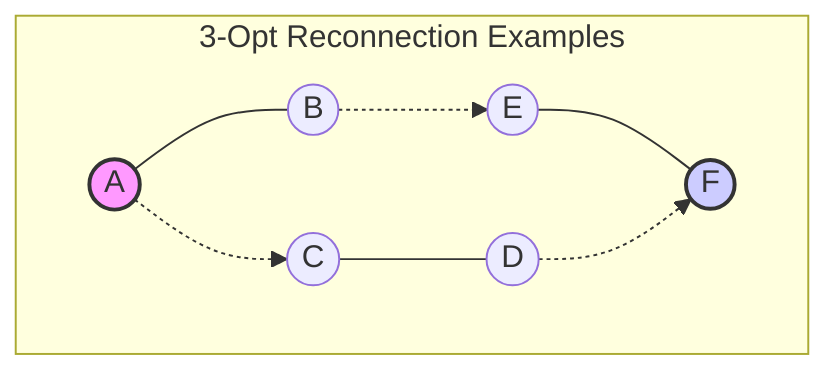

# Local Search Heuristics — Notes on Metaheuristics, 2-Opt, and Moving Beyond Construction

Once a constructive heuristic builds a feasible solution to a combinatorial problem, we need a systematic way to improve it without brute-forcing the entire search space. This post compiles extensive working notes on **local search heuristics** and the overarching framework of **metaheuristics**. 

The following notes synthesize foundational optimization theory from E. Talbi’s *Metaheuristics: From Design to Implementation* (2009) and delve deeply into the Traveling Salesman Problem (TSP) case study from Aarts and Lenstra’s *Local Search in Combinatorial Optimization* (1997).

> **Question for these notes:** Once we have constructed a feasible solution to a hard combinatorial problem, how do we systematically improve it without brute-forcing the entire search space?

---

## 1. Common Concepts for Metaheuristics (Talbi, 2009)

To understand local search, we first map out the broader landscape of optimization where these algorithms operate. 

### 1.1 Optimization Models
The mathematical formulation of a problem dictates how we approach solving it.
*   **Classical optimization models:** Assume a static, deterministic environment where all data is known upfront. Complexity theory governs our strategy here: if a problem is NP-hard, the time required to find a guaranteed global optimum scales exponentially, forcing a trade-off between solution quality and execution time.
*   **Optimization under uncertainty:** Objective values or constraints involve random variables, requiring stochastic programming (e.g., stochastic travel times in routing).
*   **Dynamic optimization:** The problem instance changes during execution. The algorithm must continuously adapt an existing solution rather than restarting from scratch (e.g., new delivery orders arriving mid-route).
*   **Multiperiodic optimization:** Decisions span multiple sequential periods; actions taken today alter the feasible state space of tomorrow.
*   **Robust optimization:** Seeks solutions that remain strictly feasible and near-optimal even if the input data experiences bounded perturbations.

### 1.2 The Spectrum of Optimization Methods
When facing these models, we categorize our solvers into distinct methodological classes:
1.  **Exact methods:** Guarantee the global optimum (e.g., Branch-and-Bound, Dynamic Programming). Feasible only for small instances of NP-hard problems.
2.  **Approximate algorithms:** Fast algorithms that provide a mathematically proven worst-case guarantee $\alpha$ relative to the optimal cost.
3.  **Greedy algorithms:** Constructive rules that make the best immediate, locally optimal choice at each step to build a solution incrementally.
4.  **Metaheuristics:** High-level, problem-independent algorithmic frameworks that provide a set of guidelines or strategies to develop heuristic optimization algorithms (e.g., Simulated Annealing, Tabu Search, Evolutionary Algorithms).

**When to use metaheuristics:** They are the tool of choice when exact methods are computationally intractable, when the objective function is a "black box" (e.g., output from a simulation), or when the environment is highly dynamic and requires rapid, flexible adaptation.

### 1.3 Core Design Components of Metaheuristics
Every metaheuristic implementation requires careful design of two main pillars:

**1. Representation (Encoding)**
How a solution is mapped into memory fundamentally shapes the search space.
*   **Linear vs. Non-linear:** Arrays and permutations are linear; trees (used in genetic programming) and graphs are non-linear.
*   **Direct vs. Indirect:** In a direct encoding, the data structure *is* the solution (e.g., an array representing the exact sequence of cities). In an indirect encoding, the data structure holds a set of rules, priorities, or parameters that a separate decoder uses to construct the solution.

**2. Objective Function**
The function $f(s)$ guides the search. 
*   **Self-sufficient vs. Guiding:** A self-sufficient objective evaluates the true cost (e.g., exact route distance). A guiding objective uses a proxy metric or adds penalties/bonuses to steer the search out of local optima.
*   **Relative & Competitive:** In some metaheuristics (like co-evolutionary algorithms), fitness is not an absolute scalar but a relative metric determined by competing against other solutions in the population.

**Supporting Components:**
A practical metaheuristic also requires rigorous **constraint handling** (usually via penalty functions to gracefully handle infeasible space), systematic **parameter tuning** (setting cooling schedules or mutation rates), and robust **performance analysis** to empirically prove convergence speed and solution quality.

---

## 2. Local Search and the TSP: A Case Study (Aarts & Lenstra, 1997)

Local search takes a complete, feasible solution and iteratively transforms it by exploring a defined **neighborhood** $N(s)$. A solution $s^*$ is a **local optimum** if no neighboring solution improves the objective:

$$f(s^*) \leq f(s) \quad \forall s \in N(s^*)$$

### 2.1 2-Opt, 3-Opt, and Their Variants
For the TSP, the most prominent neighborhood structures are based on edge-exchange operations, termed $k$-opt moves.

*   **2-Opt:** Removes two non-adjacent edges and reconnects the resulting two paths. This operation reverses the sequence of the cities on the path between the two swapped edges, effectively "uncrossing" the tour.
*   **3-Opt:** Removes three edges, breaking the tour into three disconnected segments. There are 8 ways to reconnect these segments into a single cycle. One is the original tour, three correspond to 2-opt moves (reversing one segment), and four are distinct 3-opt moves (rearranging the order of the segments without reversing them, or combining rearrangements with reversals).



The mathematical evaluation for the change in distance ($\Delta$) for a 2-opt move involving edges $(v_1, v_2)$ and $(v_3, v_4)$ is:

$$\Delta = d(v_1, v_3) + d(v_2, v_4) - \bigl(d(v_1, v_2) + d(v_3, v_4)\bigr)$$

A move is executed if $\Delta < 0$.

### 2.2 Theoretical Bounds on Local Search

The theoretical analysis of local search for the TSP reveals stark worst-case scenarios:

* **Quality Bounds:** The ratio of the length of a worst-case 2-opt local optimum to the global optimum is not bounded by a constant. Even for metric TSP, theoretical guarantees of pure local optima are weak compared to constructive approximations like Christofides.
* **Time Complexity (PLS-Completeness):** Finding a local optimum for $k$-opt is a problem in the complexity class PLS (Polynomial-time Local Search). Theoretically, there exist pathological problem instances where a local search algorithm requires an exponential number of improving steps to reach a local optimum.

### 2.3 Experimental Results for 2-Opt and 3-Opt

In stark contrast to the pessimistic theoretical bounds, the empirical performance of local search is exceptionally strong.

* **Solution Quality:** While nearest-neighbor construction might leave a gap of 20% from the optimum, applying 2-opt rapidly closes this gap to roughly 4-5%. Upgrading to 3-opt pushes the final quality to within 2-3% of the optimum.
* **Convergence Speed:** Instead of the theoretical exponential time, empirical observation shows that the number of improvement steps required scales sub-quadratically, and often near-linearly $O(n)$, with the number of cities.

### 2.4 How to Make 2-Opt and 3-Opt Run Quickly

A naive implementation of 2-Opt evaluates every pair of edges, taking $O(n^2)$ time *per improvement iteration*. For a 100,000-city instance, this is crippling. Aarts & Lenstra document critical data structures required for speed:

**1. Nearest Neighbor Lists:**
Instead of testing all $n-3$ possible alternative edges to swap with $(v_1, v_2)$, we restrict the search. For node $v_1$, we only attempt connections to nodes in its predefined neighbor list (typically the 10 to 40 closest cities).

**2. Don't-Look Bits:**
We maintain a boolean array corresponding to each city. If a city is searched and no improving move is found involving its adjacent edges, its don't-look bit is set to `true`. We skip this city in future iterations until a successful move modifies one of its adjacent edges, at which point its bit (and those of its neighbors) is reset to `false`.

```text
FAST-2-OPT(Tour, Distances, NeighborLists)
    Initialize DontLook[1..n] to False
    improvement_found ← True

    while improvement_found
        improvement_found ← False
        for i from 1 to n
            if DontLook[i] is True
                continue
            
            node1 ← Tour[i]
            node2 ← Tour[i+1]
            move_made ← False
            
            for node3 in NeighborLists[node1]
                node4 ← successor of node3 in Tour
                
                Δ ← Distances[node1, node3] + Distances[node2, node4] 
                    - Distances[node1, node2] - Distances[node3, node4]
                
                if Δ < 0
                    Tour ← REVERSE-SEGMENT(Tour, node2, node3)
                    DontLook[node1], DontLook[node2], DontLook[node3], DontLook[node4] ← False
                    improvement_found ← True
                    move_made ← True
                    break // First improvement strategy
            
            if not move_made
                DontLook[i] ← True

    return Tour
```

```text
GENERIC-FAST-LOCAL-SEARCH(s)
    initialize don't-look bits to 0 for all nodes
    improved ← true

    while improved
        improved ← false
        for each node i in s
            if dont_look[i] == 1
                continue
            
            best_move ← FIND-BEST-MOVE-IN-NEIGHBORHOOD(s, i, neighbor_lists)
            
            if best_move yields improvement
                s ← APPLY-MOVE(s, best_move)
                dont_look[affected_nodes] ← 0
                improved ← true
            else
                dont_look[i] ← 1

    return s

```

### 2.5 Parallel 2-Opt and 3-Opt

Scaling local search to millions of nodes requires parallel execution.

* **Tour Partitioning:** The graph is spatially decomposed into sectors. Threads process internal 2-opt/3-opt moves within their respective sectors simultaneously.
* **Boundary Synchronization:** When an improving move spans across the boundary of two sectors, threads must acquire locks to prevent race conditions (e.g., Thread A reversing a segment that Thread B is concurrently trying to swap out of).
* **Asynchronous Search:** Rather than waiting for all threads to finish an iteration barrier, worker threads autonomously fetch sub-tours, optimize them, and commit them back to a shared memory master tour, drastically increasing CPU utilization.

### 2.6 Other Simple Local Optimization Algorithms

While edge-exchange ($k$-opt) dominates TSP literature, other neighborhood operators are highly effective, particularly when adapting the TSP solver for more complex routing problems (like VRP with time windows):

* **Node Insertion (Shift):** Extract a single node $v_i$ from the tour and insert it between nodes $v_j$ and $v_k$. This is an $O(n^2)$ neighborhood that fundamentally alters the tour sequence without the massive edge reversals of 2-opt.
* **Node Exchange (Swap):** Swap the positions of two nodes $v_i$ and $v_j$ in the sequence.
* **Variable-Depth Search:** The logical conclusion of local search is algorithms like Lin-Kernighan, which do not fix $k$ (as in 2-opt or 3-opt) but dynamically decide how many edges to swap in a single complex move, navigating deep out of local minima by temporarily accepting sequences of sub-optimal intermediate swaps that result in a net-negative $\Delta$.

The transition from constructive algorithms to local search represents a shift from *building* to *refining*. By leveraging neighbor lists, memory bits, and parallel architecture, local search transforms theoretically daunting search spaces into computationally trivial optimization tasks.

## 3. The Bridge Between Construction and Search

Constructive algorithms make a complete tour; local search makes it less bad. You cannot run 2-Opt on an empty graph. The quality of the final local optimum is heavily dependent on the constructive heuristic used to generate the seed.

If you use a fast, randomized insertion constructor to generate 100 diverse initial tours, and run a fast 2-Opt with don't-look bits on all 100, you have essentially built a **Greedy Randomized Adaptive Search Procedure (GRASP)**—a perfect synthesis of Talbi's metaheuristic principles and Aarts & Lenstra's low-level neighborhood mechanics.

### References and Further Reading

* Talbi, E. (2009). *Metaheuristics: From Design to Implementation*. John Wiley & Sons.
* Aarts, E. H. L., & Lenstra, J. K. (Eds.). (1997). *Local Search in Combinatorial Optimization*. John Wiley & Sons.
* [TSPLIB](https://www.google.com/search?q=http://comopt.ifi.uni-heidelberg.de/software/TSPLIB95/): The standard library of TSP instances for benchmarking local search heuristics.
* [VisuAlgo - Optimization](https://visualgo.net/): Visualizations for basic optimization and graph structures.